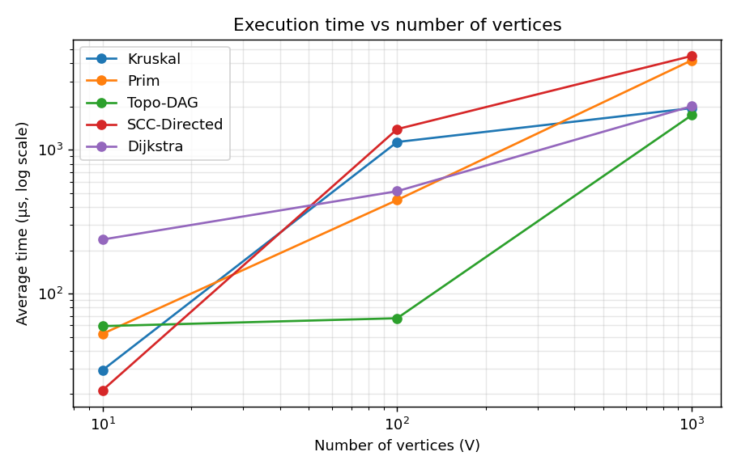
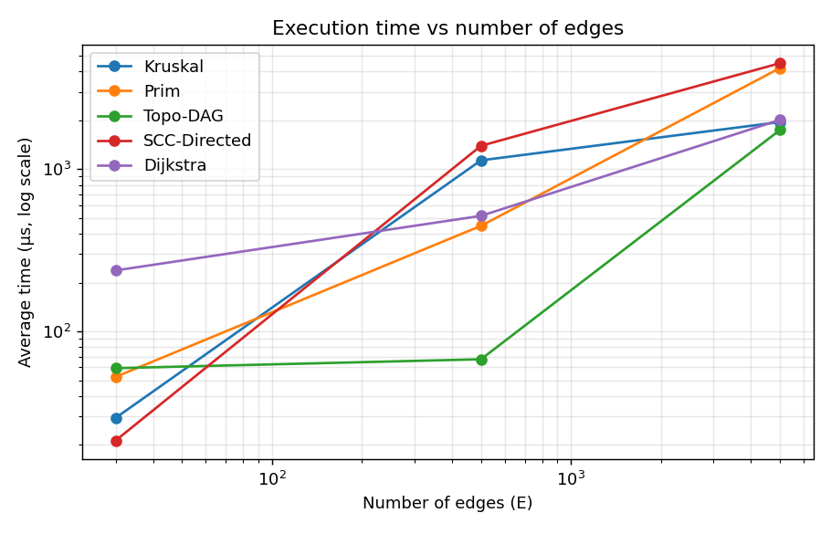
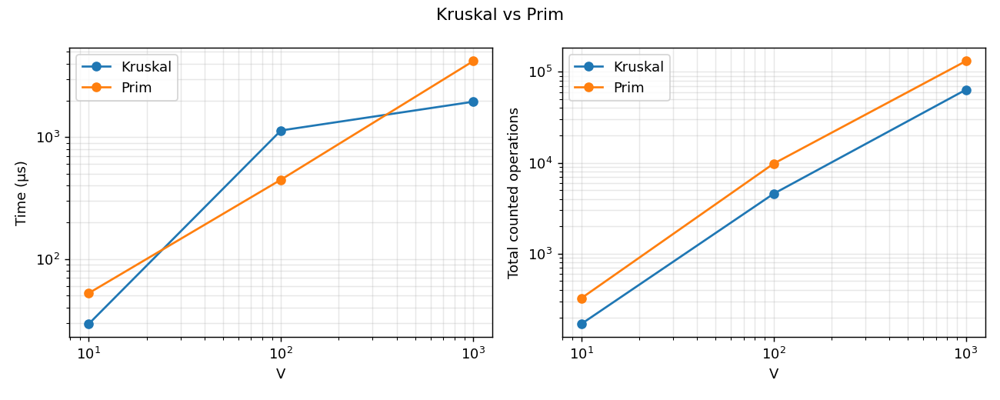
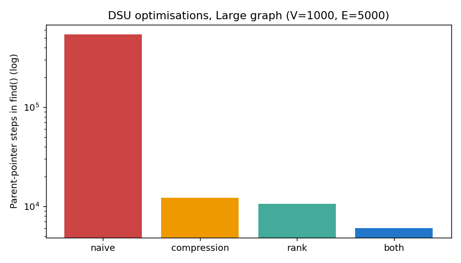

# Assignment 3 — Smart City Infrastructure and Route Planning

**Author:** _<your name, group>_  ·  **Course:** _<course name>_  ·  **Language:** Java 21 (no external libraries)

## 1. Overview

The application models a smart city as a graph:

| Graph element | City meaning | Weight meaning |
|---|---|---|
| Vertex `0..n-1` | district / location | – |
| Undirected edge | road or infrastructure link | construction cost (MST) or distance (Dijkstra) |
| Directed edge | one-way road / service dependency | – (topological order, SCC) or distance |

It solves three planning problems:

1. **Infrastructure planning** – cheapest network connecting all districts (MST: Kruskal with DSU, Prim with a priority queue).
2. **Connectivity analysis** – dependency order (topological sort) and mutually reachable groups of locations (strongly connected components).
3. **Route planning** – shortest paths from one district to all others (Dijkstra).

**Graph representation.** `graph.Graph` keeps an *adjacency list* (`List<List<Edge>>`) for traversals plus a flat *edge list* (needed by Kruskal). Undirected edges are stored once in the edge list and twice (both directions) in the adjacency list. Space: O(V + E). Weights are positive integers.

### Repository structure

```
assignment-3/
├── src/
│   ├── graph/          Edge, Graph, GraphGenerator (seeded generators)
│   ├── dsu/            DSU (path compression + union by rank, switchable for experiments)
│   ├── mst/            Kruskal, Prim, MSTResult
│   ├── connectivity/   TopologicalSort (Kahn), SCC (Kosaraju)
│   ├── shortestpath/   Dijkstra
│   ├── experiments/    Benchmark (writes results/tables/results.csv)
│   └── tests/          Tests (dependency-free test runner)
├── results/
│   ├── tables/         results.csv, results.md
│   └── plots/          *.png
├── plot_results.py     CSV -> tables + plots (matplotlib)
├── run.sh              compile + test + benchmark + plots
└── README.md
```

### How to build and run

```bash
javac -d out $(find src -name '*.java')
java -cp out tests.Tests                                   # 23 correctness checks
java -cp out experiments.Benchmark results/tables/results.csv
python3 plot_results.py                                    # needs matplotlib
```
(or simply `./run.sh`).

## 2. Implementation

* **DSU** (`dsu.DSU`): parent array + rank array. `find` is iterative with *path compression* (second pass re-points every node on the path to the root). `union` links the lower-rank root under the higher-rank root (*union by rank*). Counters `findCalls`, `unionCalls`, `pathSteps` are kept; two boolean flags can disable each optimisation so the experiment can measure its effect.
* **Kruskal** (`mst.Kruskal`): copy and sort the edge list, scan edges in order, add an edge when `union` succeeds, stop once V−1 edges are chosen. If fewer than V−1 edges are found the graph is disconnected (`connected=false`, the result is a minimum spanning forest).
* **Prim** (`mst.Prim`): binary-heap `PriorityQueue` with *lazy deletion* (stale entries are skipped when popped). It restarts from every unvisited vertex so disconnected graphs also yield a spanning forest and can be compared with Kruskal.
* **Topological sort** (`connectivity.TopologicalSort`): Kahn's algorithm (in-degree + queue). If the output has fewer than V vertices the graph has a cycle, so no ordering exists and `isDag=false` is reported. `isValidOrder` independently verifies an ordering.
* **SCC** (`connectivity.SCC`): Kosaraju – DFS on G to get finishing order, then DFS on the transposed graph in reverse finishing order. Both DFS passes are *iterative* (no stack overflow on deep graphs).
* **Dijkstra** (`shortestpath.Dijkstra`): binary heap with lazy deletion; stores `dist[]` and `prev[]`; unreachable vertices keep `dist = INF` and `pathTo` returns an empty list; throws `IllegalArgumentException` if any edge weight is negative.

### Why Dijkstra fails with negative edge weights

Dijkstra is greedy: when a vertex is extracted from the heap its distance is declared final, because any other path must go through vertices that are at least as far away and add only non-negative weight. A negative edge breaks this. Example: `A→B (2)`, `A→C (5)`, `C→B (−4)`. Dijkstra finalises `B = 2` first, but the real shortest path is `A→C→B = 1`. Re-processing finalised vertices would break the complexity guarantee, and a negative *cycle* makes shortest distances undefined. For negative weights use Bellman–Ford (O(V·E)); this project uses Bellman–Ford only as the reference oracle in the tests.

## 3. Complexity Analysis

Assumptions: graph stored as adjacency list + edge list; binary heap (`PriorityQueue`) with O(log n) push/pop and lazy deletion; V vertices, E edges; α is the inverse Ackermann function (≤ 4 for any practical n).

| Algorithm | Time | Space | Effect of V and E |
|---|---|---|---|
| DSU `find` / `union` (path compression + rank) | amortized O(α(V)) ≈ O(1) per op; m operations on n elements: O(m·α(n)) | O(V) | independent of E; depends only on the number of operations |
| DSU without optimisations | O(V) worst case per `find` (degenerate chain) | O(V) | long chains appear as V grows |
| Kruskal | O(E log E + E·α(V)) = **O(E log E)** (= O(E log V) because E ≤ V²) | O(V + E) | sorting dominates, so it grows with E; V only affects DSU size |
| Prim (binary heap, adjacency list) | **O(E log V)** (heap holds ≤ E entries, log E ≤ 2 log V) | O(V + E) | every edge can cause a push, so time grows with E; log factor with V |
| Topological sort (Kahn) | **O(V + E)** | O(V + E) (in-degree array + queue) | linear in both; stops early when a cycle blocks the queue |
| SCC (Kosaraju) | **O(V + E)** (two DFS + building the transpose) | O(V + E) | linear in both |
| Dijkstra (binary heap) | **O((V + E) log V)** | O(V + E) | E relaxations each possibly costing a heap push O(log V) |

For *dense* graphs (E ≈ V²) Prim with an array instead of a heap is O(V²), which can beat both heap versions; for *sparse* graphs (E ≈ V) all heap-based algorithms are close to O(V log V).

## 4. Experimental Setup

| Name | V | E |
|---|---|---|
| Small | 10 | 30 |
| Medium | 100 | 500 |
| Large | 1,000 | 5,000 |

**Graph generation (all with `java.util.Random` and a fixed seed, weights uniform in 1..100, no self-loops, no parallel edges):**

* *Connected undirected graph* (MST, Dijkstra; seed 42): first a random spanning tree is built (vertices are shuffled, each vertex connects to a random earlier one), which guarantees connectivity; then random unique edges are added until E is reached.
* *Random directed graph* (SCC and "graph with cycles" for topological sort; seed 43): E random unique ordered pairs. It **contains cycles**: SCC finds 3 / 4 / 14 components for Small / Medium / Large, i.e. non-trivial strongly connected components exist.
* *Random DAG* (topological sort and SCC baseline; seed 44): vertices get a hidden random ranking and every edge is directed from lower to higher rank, so the graph is **acyclic by construction**.

**Measurement.** For each algorithm and graph: 3 untimed warm-up runs (to let the JIT compile), then **5 timed runs**; the table shows the average of `System.nanoTime()` differences in microseconds. Graph generation is not included in the timings. **Operation counters** are exact and deterministic: edges examined, comparisons (counted inside the sort/heap comparators), DSU `find`/`union` calls and parent-pointer steps, heap pushes/pops, relaxations. "Total ops" in the plots is the sum of the counters (without result fields such as weight or SCC count).

## 5. Results

All numbers come from `results/tables/results.csv` (generated by `Benchmark`). Times are machine-dependent; operation counts are reproducible.

#### Kruskal vs Prim

| Algorithm | Graph | V | E | Avg time (µs) | Operation counters |
|---|---|---|---|---|---|
| Kruskal | Small | 10 | 30 | 29.32 | weight=134, edges_examined=15, comparisons=109, dsu_finds=30, dsu_unions=15 |
| Kruskal | Medium | 100 | 500 | 1133.97 | weight=1153, edges_examined=180, comparisons=3839, dsu_finds=360, dsu_unions=180 |
| Kruskal | Large | 1000 | 5000 | 1951.80 | weight=12900, edges_examined=3271, comparisons=50394, dsu_finds=6542, dsu_unions=3271 |
| Prim | Small | 10 | 30 | 52.44 | weight=134, edges_examined=60, comparisons=204, heap_pushes=30, heap_pops=30 |
| Prim | Medium | 100 | 500 | 447.50 | weight=1153, edges_examined=1000, comparisons=7770, heap_pushes=500, heap_pops=500 |
| Prim | Large | 1000 | 5000 | 4200.72 | weight=12900, edges_examined=10000, comparisons=111028, heap_pushes=5000, heap_pops=5000 |

#### DSU optimisations (inside Kruskal)

| Algorithm | Graph | V | E | Avg time (µs) | Operation counters |
|---|---|---|---|---|---|
| Kruskal-DSU-naive | Small | 10 | 30 | 59.37 | weight=134, dsu_finds=30, dsu_path_steps=22 |
| Kruskal-DSU-naive | Medium | 100 | 500 | 177.93 | weight=1153, dsu_finds=360, dsu_path_steps=2321 |
| Kruskal-DSU-naive | Large | 1000 | 5000 | 5434.72 | weight=12900, dsu_finds=6542, dsu_path_steps=543294 |
| Kruskal-DSU-compression | Small | 10 | 30 | 11.89 | weight=134, dsu_finds=30, dsu_path_steps=19 |
| Kruskal-DSU-compression | Medium | 100 | 500 | 178.39 | weight=1153, dsu_finds=360, dsu_path_steps=489 |
| Kruskal-DSU-compression | Large | 1000 | 5000 | 3380.21 | weight=12900, dsu_finds=6542, dsu_path_steps=12192 |
| Kruskal-DSU-rank | Small | 10 | 30 | 11.11 | weight=134, dsu_finds=30, dsu_path_steps=20 |
| Kruskal-DSU-rank | Medium | 100 | 500 | 144.40 | weight=1153, dsu_finds=360, dsu_path_steps=438 |
| Kruskal-DSU-rank | Large | 1000 | 5000 | 1861.88 | weight=12900, dsu_finds=6542, dsu_path_steps=10625 |
| Kruskal-DSU-both | Small | 10 | 30 | 10.09 | weight=134, dsu_finds=30, dsu_path_steps=17 |
| Kruskal-DSU-both | Medium | 100 | 500 | 92.64 | weight=1153, dsu_finds=360, dsu_path_steps=290 |
| Kruskal-DSU-both | Large | 1000 | 5000 | 2858.06 | weight=12900, dsu_finds=6542, dsu_path_steps=6045 |

#### Topological ordering (DAG vs graph with cycles)

| Algorithm | Graph | V | E | Avg time (µs) | Operation counters |
|---|---|---|---|---|---|
| Topo-DAG | Small | 10 | 30 | 59.35 | dag=true, edge_examinations=30, queue_ops=20 |
| Topo-DAG | Medium | 100 | 500 | 67.34 | dag=true, edge_examinations=500, queue_ops=200 |
| Topo-DAG | Large | 1000 | 5000 | 1743.78 | dag=true, edge_examinations=5000, queue_ops=2000 |
| Topo-Cyclic | Small | 10 | 30 | 4.45 | dag=false, edge_examinations=5, queue_ops=2 |
| Topo-Cyclic | Medium | 100 | 500 | 23.57 | dag=false, edge_examinations=15, queue_ops=4 |
| Topo-Cyclic | Large | 1000 | 5000 | 75.58 | dag=false, edge_examinations=31, queue_ops=16 |

#### SCC (Kosaraju)

| Algorithm | Graph | V | E | Avg time (µs) | Operation counters |
|---|---|---|---|---|---|
| SCC-Directed | Small | 10 | 30 | 21.26 | scc=3, edge_examinations=60 |
| SCC-Directed | Medium | 100 | 500 | 1393.59 | scc=4, edge_examinations=1000 |
| SCC-Directed | Large | 1000 | 5000 | 4501.99 | scc=14, edge_examinations=10000 |
| SCC-DAG | Small | 10 | 30 | 105.10 | scc=10, edge_examinations=60 |
| SCC-DAG | Medium | 100 | 500 | 324.19 | scc=100, edge_examinations=1000 |
| SCC-DAG | Large | 1000 | 5000 | 3497.44 | scc=1000, edge_examinations=10000 |

#### Dijkstra

| Algorithm | Graph | V | E | Avg time (µs) | Operation counters |
|---|---|---|---|---|---|
| Dijkstra | Small | 10 | 30 | 237.67 | reachable=10, edge_examinations=60, relaxations=17, heap_pushes=18, heap_pops=18 |
| Dijkstra | Medium | 100 | 500 | 515.58 | reachable=100, edge_examinations=1000, relaxations=202, heap_pushes=203, heap_pops=203 |
| Dijkstra | Large | 1000 | 5000 | 2013.28 | reachable=1000, edge_examinations=10000, relaxations=1932, heap_pushes=1933, heap_pops=1933 |


### Plots






## 6. Comparison and Discussion

**Kruskal vs Prim.** Both return exactly the same MST weight on every graph (134 / 1153 / 12900), as required. On the Large graph Kruskal needed ≈63 k counted operations versus ≈131 k for Prim, and ran in ≈2 ms versus ≈4.2 ms. Reasons: Kruskal stops after V−1 edges are accepted (it examined only 3,271 of 5,000 edges) and its sort is cache-friendly; Prim looks at every edge twice (once from each endpoint: 10,000 examinations) and performs 5,000 heap pushes and pops with ≈111 k heap comparisons. On the Medium graph the measured times are reversed (Kruskal ≈1.1 ms, Prim ≈0.45 ms) although Kruskal has fewer operations; with only 5 repetitions in a JVM this is JIT/garbage-collector noise, which is why operation counts are the more reliable evidence at small sizes. Theory (O(E log E) vs O(E log V)) predicts the same order of growth for both, which matches the roughly 10×-per-step growth in operation counts.

**DSU optimisations.** On the Large graph the number of parent-pointer steps inside `find` was: naive **543,294**, path compression only **12,192**, union by rank only **10,625**, both **6,045**. Without optimisation, unions keep attaching big trees under single vertices and build long chains, so one `find` can cost O(V). Union by rank keeps tree height ≤ log V; path compression flattens every visited path so later finds are almost O(1); together they give amortized O(α(V)). That is a ~90× reduction in work. (Wall-clock times of the four variants are noisy and close at this size, but the counters are unambiguous.)

**Topological ordering.** On the DAG the algorithm outputs all V vertices and examines each edge exactly once (30 / 500 / 5,000 edge examinations = E), which confirms O(V + E). On the random directed graph with cycles it detects impossibility very quickly (5 / 15 / 31 edge examinations): the random digraph has only a few vertices with in-degree 0, the queue empties early, and `order.size() < V` reports a cycle. So detecting a cycle can be much cheaper than a full ordering.

**SCC.** The number of edge examinations is exactly 2E (60 / 1,000 / 10,000) for both pass 1 and pass 2, so the runtime grows linearly with the graph size: ≈21 µs → ≈1.4 ms → ≈4.5 ms for 10× more vertices/edges at each step (the Medium value is inflated by JIT warm-up). The DAG has V singleton SCCs; the random digraph has 3 / 4 / 14 components.

**Dijkstra.** It examines every adjacency entry once (2E: 60 / 1,000 / 10,000) but performs only 17 / 202 / 1,932 successful relaxations (heap pushes 18 / 203 / 1,933), i.e. far fewer than E, so the practical cost is closer to O(E + V log V) on these random graphs than to the worst case. Time grows from ≈0.2 ms to ≈2 ms between Small and Large (the Small value includes JIT warm-up effects).

**Theory vs experiment.** Counted operations follow the predicted growth: linear (≈E) for topological sort, SCC and the edge scans of Dijkstra/Prim, and E log E-like growth for the sort and heap comparisons (Kruskal 109 → 3,839 → 50,394 comparisons). Wall-clock times at these sizes (microseconds to a few milliseconds) are affected by JIT compilation, GC and timer resolution, so absolute times should be read as indicative only; with three graph sizes the plots show the trend, not a precise fit.

## 7. Testing

`java -cp out tests.Tests` runs 23 checks (all pass). A small dependency-free runner is used so the project compiles with plain `javac`.

| Requirement | Test |
|---|---|
| small graph | hand-checked 4-vertex graph, MST weight 6 for Kruskal and Prim |
| disconnected graph | 5 vertices, 2 components: both algorithms report `connected=false` and the same forest weight (10) |
| graph with cycles | triangle: MST has exactly V−1 = 2 edges; cyclic digraph: topological sort reports a cycle; SCC grouping on a sample digraph |
| multiple valid MSTs | 4-cycle with all weights 1: four different MSTs, weight 3 for both algorithms |
| duplicate edge weights | 5 vertices, all weights equal: weight 16 for both |
| unreachable vertices | Dijkstra: `dist = INF`, `pathTo` empty, `reachableCount` correct |
| single vertex | MST (weight 0, connected), topological sort, SCC, Dijkstra |
| Kruskal = Prim | 300 random connected graphs of 5–34 vertices |
| topological order valid | 100 random DAGs verified edge by edge with `isValidOrder` |
| each vertex in exactly one SCC | 100 random digraphs: components are disjoint and cover all vertices; DAG ⇒ V singleton SCCs |
| Dijkstra correct | compared with Bellman–Ford on 100 random digraphs (including unreachable vertices); negative weights are rejected |
| DSU | union/find/connected/component counter |

## 8. Conclusion

* **MST:** Kruskal and Prim give identical weights. Kruskal (with DSU) is simplest on sparse graphs and when edges are already a list; it also stops early. Prim with a heap is preferable when the graph is already an adjacency list and dense (and with an array instead of a heap on very dense graphs).
* **DSU:** path compression + union by rank are essential — they cut parent-pointer work by about 90× on the Large graph and make Kruskal's union-find part effectively constant time.
* **Topological sort / SCC:** both are linear O(V + E). Use topological sort for dependency ordering of infrastructure services (and as a cycle detector), SCC to find groups of districts that can reach each other (e.g. to check that a one-way road system doesn't leave areas cut off).
* **Dijkstra:** appropriate for route planning with non-negative distances; O((V + E) log V) with a heap. For negative weights use Bellman–Ford.
* Experiments were reproducible via fixed seeds; operation counts match the theoretical growth, while wall-clock times at this small scale are noisy.
